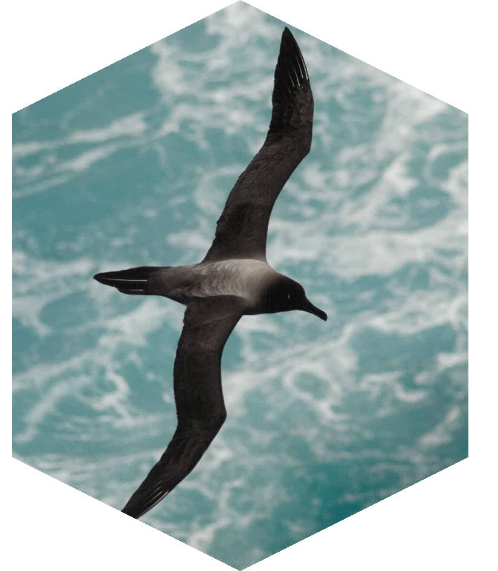

<!-- README.md is generated from README.Rmd. Please edit that file -->

```{r, include = FALSE}
knitr::opts_chunk$set(
  collapse = TRUE,
  comment = "#>",
  fig.path = "man/figures/README-",
  out.width = "100%"
)
```


# sooty  


<!-- badges: start -->
[](https://github.com/mdsumner/sooty/actions/workflows/R-CMD-check.yaml)
[](https://CRAN.R-project.org/package=sooty)
<!-- badges: end -->

The goal of sooty is to provide access to data of relevance to Southern Ocean research. 

To see what files we know about in public stores, use 

```{r sooty}
library(sooty)
(files <- sooty_files())
```

The main columns of interest are `date` and `source` and `Dataset`, the `source` is a directly useable source identifier that a GDAL-enabled package can read. (See examples below).

We can get a very simple model of a "logical dataset" by honing in one `Dataset` in particular. First let's make a summary from everything: 

```{r summary}
library(sooty)
sooty_files() |> 
     dplyr::mutate(date = as.Date(date)) |>  dplyr::group_by(Dataset) |> 
     dplyr::summarize(earliest = min(date), latest = max(date), n = dplyr::n()) |> 
     dplyr::arrange(Dataset, earliest)
```

```{r terra}
library(terra)
file <- files$source[which.max(files$date) ]
print(file)


rast(file)
```


The available datasets can be found from the table. 

```{r datasets}
dplyr::distinct(sooty_files(), Dataset)
```

There are data sets like the 3.125km resolution south polar stereographic sea ice concentration, available via the dataset identifier: 

```{r south}
icefiles <- sooty_files() |> dplyr::filter(Dataset == "antarctica-amsr2-asi-s3125-tif")
dplyr::glimpse(icefiles)
```

You can immediately see what range of dates is available: 


```{r oldest}
range(icefiles$date)
```

And, explore exactly what source files are available: 

```{r files}

range(diff(icefiles$date))  ## there are some gaps, some days are missing

diff(range(icefiles$date))  ## the number of potential data days

nrow(icefiles)  ## the actual number of data days
```

This is a very experimental begin at replacing [raadtools](https://github.com/AustralianAntarcticDivision/raadtools) with a package anyone can use. 


We can read from the datasets with a GDAL-ready package, such as terra. But note that we need to set a configuration first, and we need to unset it after,  this is WIP. 

```{r}
amsrfiles <- datasource("antarctica-amsr2-asi-s3125-tif")@source
library(terra)

r <- rast(tail(amsrfiles$source, 1))
dim(r); substr(crs(r), 0, 98); ext(r)
r[r > 100] <- NA
plot(r[[nlyr(r)]] * 1, main = format(max(icefiles$date)))
ghrsst <- datasource("ghrsst-tif")
sstfile <- ghrsst@source$source[match(max(icefiles$date), ghrsst@source$date)]
sst <- rast(sprintf("vrt://%s?ovr=4", sstfile))
ct <- as.contour(crop(sst, ext(-180, 180, -90, -40)))
plot(project(ct, crs(r)), add = TRUE, col = "hotpink")
```

That should be the state of the sea ice in the Southern Ocean at the latest available date, sea ice concentration from passive microwave at 3.125km resolution, by the AWI artist sea ice group. 

## Where the files are, and what is current

sooty began as a catalogue of object storage on the Pawsey Supercomputing Research Centre. Those buckets are no longer public, and since version 0.7.0 the catalogue points at where each file is public today.

| Datasets | Files | Status |
|---|---|---|
| `ghrsst-tif` | [Source Cooperative, ausantarctic](https://source.coop/ausantarctic) | current |
| `oisst-avhrr-v02r01` | NOAA open data bucket | current |
| `SEALEVEL_GLO_PHY_L4` | Copernicus Marine native files | current |
| `NSIDC_SEAICE_PS_N25km`, `NSIDC_SEAICE_PS_S25km` | NSIDC, as indexed by raad.virtualize | current |
| `antarctica-amsr2-asi-s3125-tif`, `BREMEN-SEAICE-SMOS-*` | Pawsey to 2025-08, then University of Bremen | current |
| `ccmp-wind-product-v2` | Remote Sensing Systems | current |
| `esacci-oc-*` monthly and 5day | Pawsey | current |
| `esacci-oc-*` daily and annual | Pawsey | archive, ends 2025-03 |
| `oisst-tif`, `sealevel-*-tif` | Pawsey | archive, ends 2025-05 |

`NSIDC_SEAICE_PS_N25km` and `NSIDC_SEAICE_PS_S25km` are a different product from before, on the same grids: the NOAA/NSIDC climate data record (G02202 version 6, variable `cdr_seaice_conc`) in place of NSIDC-0051 and NSIDC-0081, which NSIDC serves only to a login.

The archives are not extended. The work has moved to whole datasets that open as one array rather than a file per date: the virtual stores of [raad.virtualize](https://mdsumner.github.io/raad.virtualize/) on Source Cooperative (GHRSST, OISST, sea ice, ocean colour, bathymetry and more), and the Copernicus Marine Zarr stores that [cmemsarco](https://github.com/hypertidy/cmemsarco) lists (altimetry and every other Copernicus Marine product).

## About the columns in `sooty_files()`

`Dataset` is the main grouping value, and files from different `Dataset`s are otherwise non-relatable, be it by file format, available variable/s, grid specification (spatial extent and resolution), or temporal organization.  We guarantee that within a Dataset, the files are ordered and unique by date(-time) and that they are  exactly relatable spatially and (mostly, or usually also) by variable/s. The time series may not be regular or complete, but usually is.
 
We retain the component parts of `source`, as `Protocol`, `Host`, `Bucket`, and `Key`: `Bucket` is the first part of the path at `Host` and `Key` is the rest. (We use `https://` by default to avoid any required configurations). Get in touch if you have any questions about this. 

## S7 object control

We have an in-progress class for dataset handling. Create a 'datasource()' and set an id. 

```{r object}
ds <- datasource()
ds@id <- "oisst-avhrr-v02r01"
ds

ds@source
```


## Code of Conduct
  
Please note that the idt project is released with a [Contributor Code of Conduct](https://contributor-covenant.org/version/2/1/CODE_OF_CONDUCT.html). By contributing to this project, you agree to abide by its terms.

