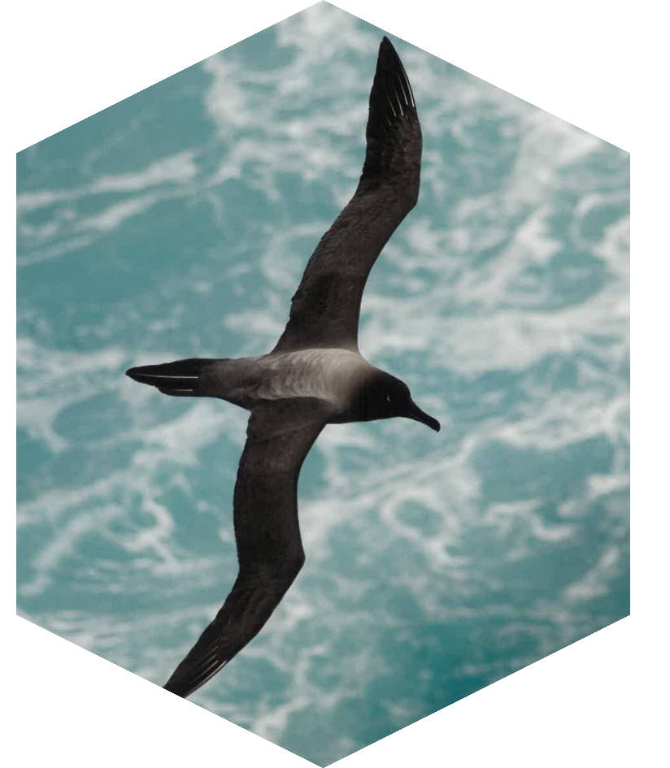
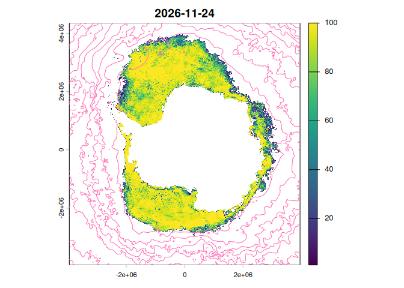

<!-- README.md is generated from README.Rmd. Please edit that file -->

# sooty 

<!-- badges: start -->

[](https://github.com/mdsumner/sooty/actions/workflows/R-CMD-check.yaml)
[](https://CRAN.R-project.org/package=sooty)
<!-- badges: end -->

The goal of sooty is to provide access to data of relevance to Southern
Ocean research.

To see what files we know about in public stores, use

``` r
library(sooty)
(files <- sooty_files())
#> # A tibble: 240,195 × 7
#>    date                source                Dataset Bucket Key   Protocol Host 
#>    <dttm>              <chr>                 <chr>   <chr>  <chr> <chr>    <chr>
#>  1 2002-06-01 00:00:00 /vsicurl/https://dat… ghrsst… ausan… ghrs… /vsicurl http…
#>  2 2002-06-02 00:00:00 /vsicurl/https://dat… ghrsst… ausan… ghrs… /vsicurl http…
#>  3 2002-06-03 00:00:00 /vsicurl/https://dat… ghrsst… ausan… ghrs… /vsicurl http…
#>  4 2002-06-04 00:00:00 /vsicurl/https://dat… ghrsst… ausan… ghrs… /vsicurl http…
#>  5 2002-06-05 00:00:00 /vsicurl/https://dat… ghrsst… ausan… ghrs… /vsicurl http…
#>  6 2002-06-06 00:00:00 /vsicurl/https://dat… ghrsst… ausan… ghrs… /vsicurl http…
#>  7 2002-06-07 00:00:00 /vsicurl/https://dat… ghrsst… ausan… ghrs… /vsicurl http…
#>  8 2002-06-08 00:00:00 /vsicurl/https://dat… ghrsst… ausan… ghrs… /vsicurl http…
#>  9 2002-06-09 00:00:00 /vsicurl/https://dat… ghrsst… ausan… ghrs… /vsicurl http…
#> 10 2002-06-10 00:00:00 /vsicurl/https://dat… ghrsst… ausan… ghrs… /vsicurl http…
#> # ℹ 240,185 more rows
```

The main columns of interest are `date` and `source` and `Dataset`, the
`source` is a directly useable source identifier that a GDAL-enabled
package can read. (See examples below).

We can get a very simple model of a “logical dataset” by honing in one
`Dataset` in particular. First let’s make a summary from everything:

``` r
library(sooty)
sooty_files() |> 
     dplyr::mutate(date = as.Date(date)) |>  dplyr::group_by(Dataset) |> 
     dplyr::summarize(earliest = min(date), latest = max(date), n = dplyr::n()) |> 
     dplyr::arrange(Dataset, earliest)
#> # A tibble: 24 × 4
#>    Dataset                             earliest   latest         n
#>    <chr>                               <date>     <date>     <int>
#>  1 BREMEN-SEAICE-SMOS-north            2010-05-01 2026-11-25  6027
#>  2 BREMEN-SEAICE-SMOS-south            2010-10-01 2016-05-03    12
#>  3 NSIDC_SEAICE_PS_N25km               1978-10-25 2026-11-19 17461
#>  4 NSIDC_SEAICE_PS_S25km               1978-10-25 2026-11-19 17489
#>  5 SEALEVEL_GLO_PHY_L4                 1993-01-01 2026-11-26 12383
#>  6 antarctica-amsr2-asi-s3125-tif      2012-07-02 2026-11-24  5248
#>  7 ccmp-wind-product-v2                1993-01-02 2026-10-31 12343
#>  8 esacci-oc-l3s-chlor-a-merged-5day   1997-09-03 2026-09-18  2127
#>  9 esacci-oc-l3s-chlor-a-merged-annual 1997-09-01 2024-09-01    28
#> 10 esacci-oc-l3s-chlor-a-merged-daily  1997-09-04 2025-03-31 10045
#> # ℹ 14 more rows
```

``` r
library(terra)
#> terra 1.9.50
file <- files$source[which.max(files$date) ]
print(file)
#> [1] "/vsicurl/https://s3.waw3-1.cloudferro.com/mdl-native-07/native/SEALEVEL_GLO_PHY_L4_NRT_008_046/cmems_obs-sl_glo_phy-ssh_nrt_allsat-l4-duacs-0.125deg_P1D_202506/2026/11/nrt_global_allsat_phy_l4_20261126_20261126.nc"


rast(file)
#> Warning: [rast] no geotransform; using GDAL geolocation arrays (project/rectify
#> to georeference)
#> class       : SpatRaster
#> size        : 1440, 2880, 10  (nrow, ncol, nlyr)
#> resolution  : 0.125, 0.125  (x, y)
#> extent      : -180, 180, -90, 90  (xmin, xmax, ymin, ymax)
#> coord. ref. : +proj=longlat +a=6378136.3 +rf=298.257 +no_defs
#> sources     : nrt_global_allsat_phy_l4_20261126_20261126.nc
#> varnames    : adt (Absolute dynamic topography)
#>               err_sla (Formal mapping error)
#>               err_ugosa (Formal mapping error on zonal geostrophic velocity anomalies)
#>               err_vgosa (Formal mapping error on meridional geostrophic velocity anomalies)
#>               flag_ice (Ice Flag for a 15% criterion of ice concentration)
#>               ...
#> names       : adt, err_sla, err_ugosa, err_vgosa, flag_ice, sla, ...
#> unit        :   m,       m,       m/s,       m/s,         ,   m, ...
#> time (days) : 2026-11-26
```

The available datasets can be found from the table.

``` r
dplyr::distinct(sooty_files(), Dataset)
#> # A tibble: 24 × 1
#>    Dataset                          
#>    <chr>                            
#>  1 ghrsst-tif                       
#>  2 oisst-avhrr-v02r01               
#>  3 oisst-tif                        
#>  4 antarctica-amsr2-asi-s3125-tif   
#>  5 BREMEN-SEAICE-SMOS-north         
#>  6 BREMEN-SEAICE-SMOS-south         
#>  7 NSIDC_SEAICE_PS_N25km            
#>  8 NSIDC_SEAICE_PS_S25km            
#>  9 ccmp-wind-product-v2             
#> 10 esacci-oc-l3s-chlor-a-merged-5day
#> # ℹ 14 more rows
```

There are data sets like the 3.125km resolution south polar
stereographic sea ice concentration, available via the dataset
identifier:

``` r
icefiles <- sooty_files() |> dplyr::filter(Dataset == "antarctica-amsr2-asi-s3125-tif")
dplyr::glimpse(icefiles)
#> Rows: 5,248
#> Columns: 7
#> $ date     <dttm> 2012-07-02, 2012-07-03, 2012-07-04, 2012-07-05, 2012-07-06, …
#> $ source   <chr> "/vsicurl/https://projects.pawsey.org.au/aad-derived/idea-ams…
#> $ Dataset  <chr> "antarctica-amsr2-asi-s3125-tif", "antarctica-amsr2-asi-s3125…
#> $ Bucket   <chr> "aad-derived", "aad-derived", "aad-derived", "aad-derived", "…
#> $ Key      <chr> "idea-amsr2-asi-s3125/seaice.uni-bremen.de/data/amsr2/asi_day…
#> $ Protocol <chr> "/vsicurl", "/vsicurl", "/vsicurl", "/vsicurl", "/vsicurl", "…
#> $ Host     <chr> "https://projects.pawsey.org.au", "https://projects.pawsey.or…
```

You can immediately see what range of dates is available:

``` r
range(icefiles$date)
#> [1] "2012-07-02 UTC" "2026-11-24 UTC"
```

And, explore exactly what source files are available:

``` r

range(diff(icefiles$date))  ## there are some gaps, some days are missing
#> Time differences in days
#> [1] 1 5

diff(range(icefiles$date))  ## the number of potential data days
#> Time difference of 5258 days

nrow(icefiles)  ## the actual number of data days
#> [1] 5248
```

This is a very experimental begin at replacing
[raadtools](https://github.com/AustralianAntarcticDivision/raadtools)
with a package anyone can use.

We can read from the datasets with a GDAL-ready package, such as terra.
But note that we need to set a configuration first, and we need to unset
it after, this is WIP.

``` r
amsrfiles <- datasource("antarctica-amsr2-asi-s3125-tif")@source
library(terra)

r <- rast(tail(amsrfiles$source, 1))
dim(r); substr(crs(r), 0, 98); ext(r)
#> [1] 2656 2528    1
#> [1] "PROJCRS[\"WGS 84 / NSIDC Sea Ice Polar Stereographic South\",\n    BASEGEOGCRS[\"WGS 84\",\n        ENSE"
#> SpatExtent : -3950000, 3950000, -3950000, 4350000 (xmin, xmax, ymin, ymax)
r[r > 100] <- NA
plot(r[[nlyr(r)]] * 1, main = format(max(icefiles$date)))
ghrsst <- datasource("ghrsst-tif")
sstfile <- ghrsst@source$source[match(max(icefiles$date), ghrsst@source$date)]
sst <- rast(sprintf("vrt://%s?ovr=4", sstfile))
ct <- as.contour(crop(sst, ext(-180, 180, -90, -40)))
plot(project(ct, crs(r)), add = TRUE, col = "hotpink")
```



That should be the state of the sea ice in the Southern Ocean at the
latest available date, sea ice concentration from passive microwave at
3.125km resolution, by the AWI artist sea ice group.

## Where the files are, and what is current

sooty began as a catalogue of object storage on the Pawsey
Supercomputing Research Centre. Those buckets are no longer public, and
since version 0.7.0 the catalogue points at where each file is public
today.

| Datasets | Files | Status |
|----|----|----|
| `ghrsst-tif` | [Source Cooperative, ausantarctic](https://source.coop/ausantarctic) | current |
| `oisst-avhrr-v02r01` | NOAA open data bucket | current |
| `SEALEVEL_GLO_PHY_L4` | Copernicus Marine native files | current |
| `NSIDC_SEAICE_PS_N25km`, `NSIDC_SEAICE_PS_S25km` | NSIDC | current |
| `antarctica-amsr2-asi-s3125-tif`, `BREMEN-SEAICE-SMOS-*` | Pawsey to 2025-08, then University of Bremen | current |
| `ccmp-wind-product-v2` | Remote Sensing Systems | current |
| `esacci-oc-*` monthly and 5day | Pawsey | current |
| `esacci-oc-*` daily and annual | Pawsey | archive, ends 2025-03 |
| `oisst-tif`, `sealevel-*-tif` | Pawsey | archive, ends 2025-05 |

`NSIDC_SEAICE_PS_N25km` and `NSIDC_SEAICE_PS_S25km` are a different
product from before, on the same grids: the NOAA/NSIDC climate data
record (G02202 version 6, variable `cdr_seaice_conc`) in place of
NSIDC-0051 and NSIDC-0081, which NSIDC serves only to a login. Days for
which that record has no data are not listed (the longest run is
1987-12-03 to 1988-01-13).

The archives are not extended. The work has moved to whole datasets that
open as one array rather than a file per date: the virtual stores of
[raad.virtualize](https://mdsumner.github.io/raad.virtualize/) on Source
Cooperative (GHRSST, OISST, sea ice, ocean colour, bathymetry and more),
and the Copernicus Marine Zarr stores that
[cmemsarco](https://github.com/hypertidy/cmemsarco) lists (altimetry and
every other Copernicus Marine product).

## About the columns in `sooty_files()`

`Dataset` is the main grouping value, and files from different
`Dataset`s are otherwise non-relatable, be it by file format, available
variable/s, grid specification (spatial extent and resolution), or
temporal organization. We guarantee that within a Dataset, the files are
ordered and unique by date(-time) and that they are exactly relatable
spatially and (mostly, or usually also) by variable/s. The time series
may not be regular or complete, but usually is.

We retain the component parts of `source`, as `Protocol`, `Host`,
`Bucket`, and `Key`: `Bucket` is the first part of the path at `Host`
and `Key` is the rest. (We use `https://` by default to avoid any
required configurations). Get in touch if you have any questions about
this.

## S7 object control

We have an in-progress class for dataset handling. Create a
‘datasource()’ and set an id.

``` r
ds <- datasource()
ds@id <- "oisst-avhrr-v02r01"
ds
#> <sooty::dataset>
#>  @ id     : chr "oisst-avhrr-v02r01"
#>  @ n      : int 16515
#>  @ mindate: POSIXct[1:1], format: "1981-09-01"
#>  @ maxdate: POSIXct[1:1], format: "2026-11-18"
#>  @ source : tibble [16,515 × 7] (S3: tbl_df/tbl/data.frame)
#>  $ date    : POSIXct[1:16515], format: "1981-09-01" "1981-09-02" ...
#>  $ source  : chr [1:16515] "/vsicurl/https://noaa-cdr-sea-surface-temp-optimum-interpolation-pds.s3.amazonaws.com/data/v2.1/avhrr/198109/oi"| __truncated__ "/vsicurl/https://noaa-cdr-sea-surface-temp-optimum-interpolation-pds.s3.amazonaws.com/data/v2.1/avhrr/198109/oi"| __truncated__ "/vsicurl/https://noaa-cdr-sea-surface-temp-optimum-interpolation-pds.s3.amazonaws.com/data/v2.1/avhrr/198109/oi"| __truncated__ "/vsicurl/https://noaa-cdr-sea-surface-temp-optimum-interpolation-pds.s3.amazonaws.com/data/v2.1/avhrr/198109/oi"| __truncated__ ...
#>  $ Dataset : chr [1:16515] "oisst-avhrr-v02r01" "oisst-avhrr-v02r01" "oisst-avhrr-v02r01" "oisst-avhrr-v02r01" ...
#>  $ Bucket  : chr [1:16515] "data" "data" "data" "data" ...
#>  $ Key     : chr [1:16515] "v2.1/avhrr/198109/oisst-avhrr-v02r01.19810901.nc" "v2.1/avhrr/198109/oisst-avhrr-v02r01.19810902.nc" "v2.1/avhrr/198109/oisst-avhrr-v02r01.19810903.nc" "v2.1/avhrr/198109/oisst-avhrr-v02r01.19810904.nc" ...
#>  $ Protocol: chr [1:16515] "/vsicurl" "/vsicurl" "/vsicurl" "/vsicurl" ...
#>  $ Host    : chr [1:16515] "https://noaa-cdr-sea-surface-temp-optimum-interpolation-pds.s3.amazonaws.com" "https://noaa-cdr-sea-surface-temp-optimum-interpolation-pds.s3.amazonaws.com" "https://noaa-cdr-sea-surface-temp-optimum-interpolation-pds.s3.amazonaws.com" "https://noaa-cdr-sea-surface-temp-optimum-interpolation-pds.s3.amazonaws.com" ...

ds@source
#> # A tibble: 16,515 × 7
#>    date                source                Dataset Bucket Key   Protocol Host 
#>    <dttm>              <chr>                 <chr>   <chr>  <chr> <chr>    <chr>
#>  1 1981-09-01 00:00:00 /vsicurl/https://noa… oisst-… data   v2.1… /vsicurl http…
#>  2 1981-09-02 00:00:00 /vsicurl/https://noa… oisst-… data   v2.1… /vsicurl http…
#>  3 1981-09-03 00:00:00 /vsicurl/https://noa… oisst-… data   v2.1… /vsicurl http…
#>  4 1981-09-04 00:00:00 /vsicurl/https://noa… oisst-… data   v2.1… /vsicurl http…
#>  5 1981-09-05 00:00:00 /vsicurl/https://noa… oisst-… data   v2.1… /vsicurl http…
#>  6 1981-09-06 00:00:00 /vsicurl/https://noa… oisst-… data   v2.1… /vsicurl http…
#>  7 1981-09-07 00:00:00 /vsicurl/https://noa… oisst-… data   v2.1… /vsicurl http…
#>  8 1981-09-08 00:00:00 /vsicurl/https://noa… oisst-… data   v2.1… /vsicurl http…
#>  9 1981-09-09 00:00:00 /vsicurl/https://noa… oisst-… data   v2.1… /vsicurl http…
#> 10 1981-09-10 00:00:00 /vsicurl/https://noa… oisst-… data   v2.1… /vsicurl http…
#> # ℹ 16,505 more rows
```

## Code of Conduct

Please note that the idt project is released with a [Contributor Code of
Conduct](https://contributor-covenant.org/version/2/1/CODE_OF_CONDUCT.html).
By contributing to this project, you agree to abide by its terms.
